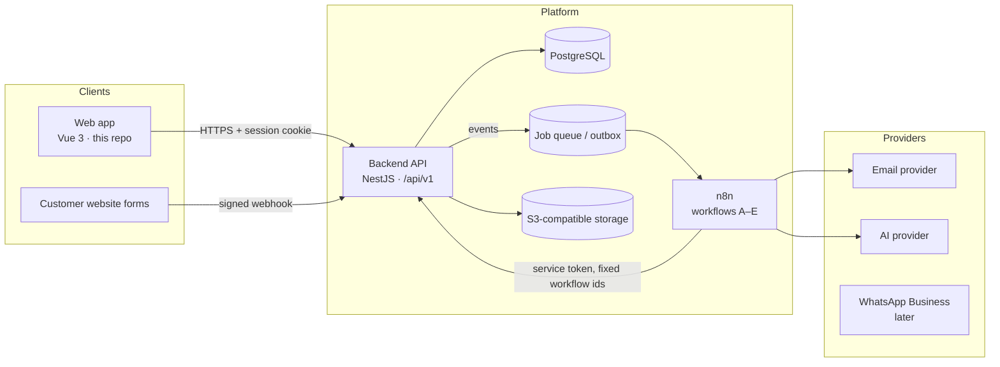
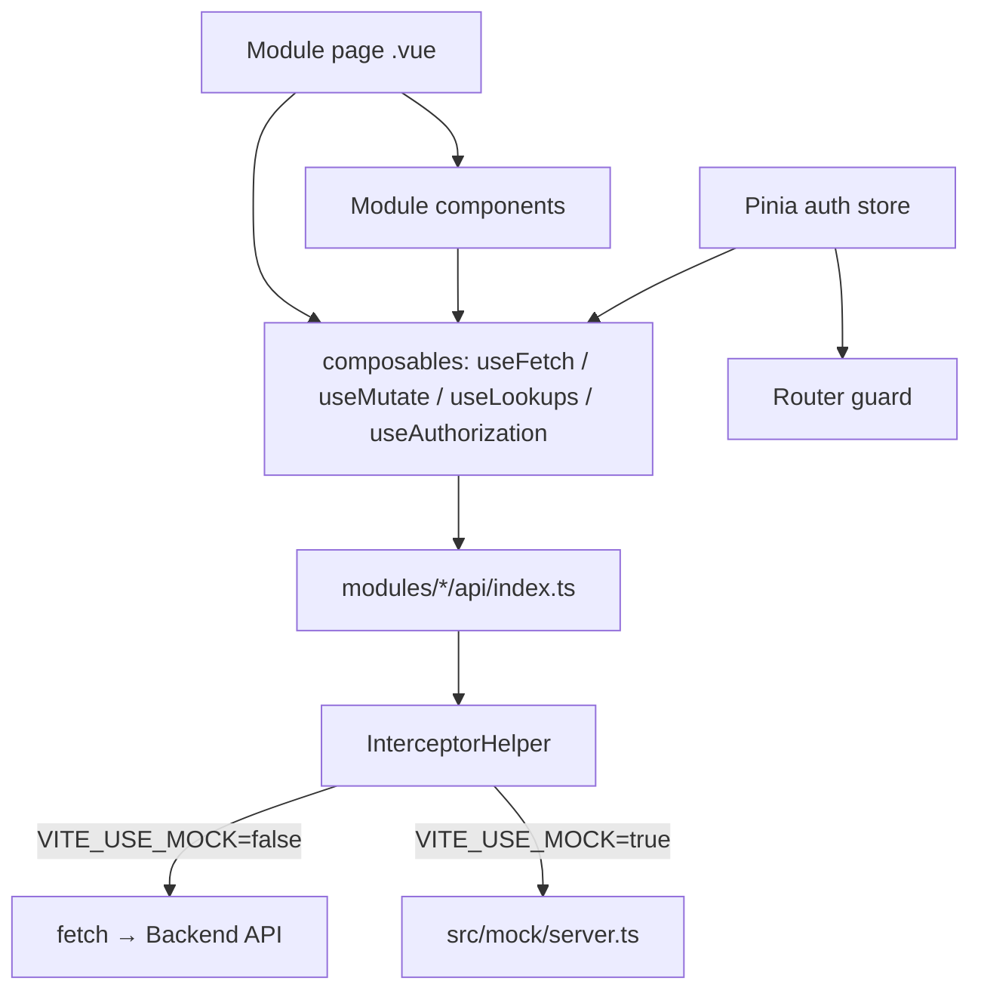
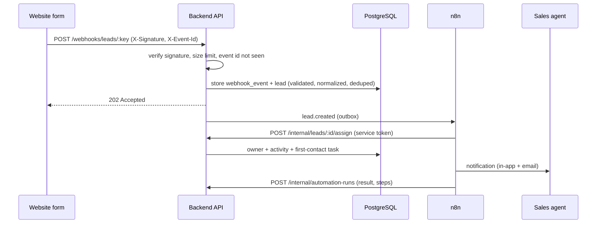

# Architecture

## 1. System overview



**Design rule:** every important business event is **saved by the backend first**, then the workflow runs. The browser never triggers automations directly, never talks to the database, never holds integration secrets, and never chooses which n8n workflow runs.

### Why a separate backend

The product is multi-tenant with permissions and commercial data. The backend is responsible for:

- verifying the user and their organization on every request;
- authorizing every request at record and organization level (including requests from n8n);
- validating input and enforcing the business rules ([PRD §6](PRD.md#6-business-rules));
- de-duplication and idempotency;
- storing events, tasks, activity and audit logs;
- exposing a safe API to the frontend and to n8n;
- enforcing plan limits.

## 2. Recommended stack

| Part | Technology | Responsibility |
| --- | --- | --- |
| Frontend | Vue 3 + Vite + TypeScript (this repo) | User interface |
| UI | Tailwind CSS + PrimeVue 4 (Aura, re-tinted) | Design system and components |
| Forms | VeeValidate + Yup | Input validation (re-validated by the API) |
| Data fetching | TanStack Vue Query | Caching, invalidation, polling |
| State | Pinia | Session (user, organization, membership), theme |
| i18n | vue-i18n | English + Arabic (RTL) |
| Backend | NestJS (or equivalent) | Business logic and permissions |
| Database | PostgreSQL 15+ | Product data |
| ORM | Prisma or Drizzle | Database access and migrations |
| Automation | n8n (self-hosted) | Workflow execution |
| Auth | Secure HttpOnly session cookies (or a trusted auth provider) | Sign-in and sessions |
| Files | S3-compatible storage | Import files, exports |
| Email | SMTP or an email API provider | Notifications and reports |
| Monitoring | Error tracking + structured logs | Errors and performance |
| Deployment | Docker + managed hosting | Services and releases |

The original brief suggested Nuxt 3; this repo keeps the existing **Vite SPA** structure as requested. The app is fully authenticated (no public SEO pages), so SSR adds little. A marketing site can be built separately.

## 3. Target repository layout (full product)

```text
leadflow/
├── apps/
│   ├── web/            # this repository
│   └── api/            # backend API
├── packages/
│   ├── shared-types/   # generated from docs/API.md / OpenAPI (src/types/domain.ts today)
│   └── validation/     # shared schemas
├── infrastructure/{docker,deployment,monitoring}/
├── n8n/{workflows,credentials-guide,workflow-docs}/
└── docs/
```

Starting with two separate repositories (web, api) is fine if that suits the team better.

## 4. Frontend architecture

### 4.1 Layers



- **`InterceptorHelper`** is the only place that calls `fetch`. It adds `Accept-Language`, `X-Request-Id`, the optional `Idempotency-Key`, `credentials: 'include'` and the bearer token (mock/API clients only). It also unwraps the standard error envelope into toasts. The 401 handling clears the session.
- **Module `api/index.ts`** files are thin, typed wrappers around one endpoint each (types from `src/types/domain.ts`).
- **Query keys start with the resource name** (`['leads', …]`, `['tasks', …]`), so a mutation invalidates every view of that resource with `invalidateQueries({ queryKey: ['leads'] })`.
- **Lookups** (stages, sources, active members, tags) are cached queries shared by forms, filters and the board (`composables/useLookups.ts`). Only *active* members are offered as owners or assignees.

### 4.2 Routing and access

`router/index.ts` guard order:

1. Public routes (invite acceptance, 404) pass.
2. No session → `/login?redirect=…`.
3. Session → load `/auth/me` once (user, organization, membership + permissions).
4. Organization not onboarded and user can manage settings → `/onboarding`.
5. `meta.permission` (any of) not held → `/forbidden`.

The sidebar (`composables/useSideBar.ts`) filters items with the same permissions, and buttons are hidden with `useAuthorization().can(…)`. **This is convenience only. The API authorizes every request again.**

### 4.3 Modules

| Module | Routes | Key components |
| --- | --- | --- |
| auth | `/login`, `/register`, `/forget-password`, `/reset-password`, `/invite/:token` | `useLoginForm`, `usePasswordRules` |
| onboarding | `/onboarding` | 4-step wizard |
| dashboard | `/dashboard` | `StatCard`, `WidgetCard`, `BarList`, `PeriodFilter` |
| leads | `/leads`, `/leads/:id` | `LeadForm`, `LeadImportModal`, `BulkActionsBar`, `MoveStageModal`, `ActivityTimeline`, `AiInsightsPanel`, `LeadRunsPanel` |
| pipeline | `/pipeline` | Kanban on `vuedraggable` |
| tasks | `/tasks` | `TaskForm`, `TaskRow`, `CompleteTaskModal` |
| automations | `/automations`, `/automation-runs` | `AutomationConfigModal` |
| integrations | `/integrations` | `ConnectIntegrationModal` |
| reports | `/reports` | `FunnelChart`, `BarList` |
| notifications | `/notifications` (+ navbar bell) | `useNotifications` |
| settings | `/settings/:tab?` | General, Members, Roles, Pipeline, Sources, Notifications, Billing, Audit |
| profile | `/profile` | Password, sessions |

### 4.4 UI conventions

- Every widget/list has loading, empty and error (with retry) states.
- Destructive actions ask for confirmation; forms keep their values when a save fails and map API `details` back onto fields.
- Lists use server-side pagination, search and filtering; the leads filters persist in `sessionStorage`.
- Metrics show their definition (ⓘ tooltip on every KPI; definitions section on Reports).
- Charts are single-hue magnitude bars with the value printed as text; tables accompany them on Reports.
- RTL: `dir` is set on `<body>` from the locale; layouts use logical properties (`ms-`, `pe-`, `start-`).
- Dark mode via the `.dark` class and CSS variables in `assets/styles/_variables.scss`.

## 5. Mock API (`src/mock`)

Lets the product be demoed and the UI be developed before the backend exists, **and** serves as an executable specification of the business rules.

| File | Role |
| --- | --- |
| `db.ts` | Flat tables mirroring [DATABASE.md](DATABASE.md), deterministic seed (two organizations), `localStorage` persistence |
| `rules.ts` | Business rules + workflows A–E: normalization, dedupe, assignment, AI classification, stage moves, stop-on-close, scheduled checks |
| `serializers.ts` | Row → API shape, pagination, record-level visibility |
| `server.ts` | Router, session check, `Idempotency-Key` replay, error envelope, request size limit |
| `handlers/*.ts` | Endpoints grouped by area (auth, leads, work, automation, insights, org) |

`InterceptorHelper` loads it with a dynamic `import()` only when `VITE_USE_MOCK=true`, so it never runs in a build that targets the real API. `tests/mock-api.smoke.ts` (`npm run test:mock`) checks the rules end to end.

**When the real backend ships:** set `VITE_USE_MOCK=false` and point `VITE_APP_API_URL` at it. The backend team can port `rules.ts` almost one-to-one into services, and reuse the smoke test as the start of the API test suite.

## 6. Data flow examples

### New website lead (Workflow A + B)



### Lead marked Won

`POST /leads/:id/move` → backend writes stage history and activity, cancels the lead's open **automated** tasks (stop-on-close), clears `next_follow_up_at`, and records an automation run. Manual tasks stay for the salesperson to close.
