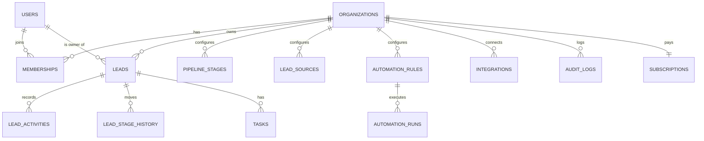

# Database — PostgreSQL schema

**Core rule:** every customer-owned row carries `organization_id`, and ownership is verified **on the server**, never only in the frontend. Optional defence in depth: PostgreSQL Row-Level Security keyed on `current_setting('app.organization_id')`.

## 1. Entity overview



## 2. Tables

| Table | Key fields | Purpose |
| --- | --- | --- |
| organizations | id, name, industry, timezone, locale, currency, business_hours, plan_id | Tenants |
| users | id, name, email, password_hash, status | Accounts (global; one user can join several organizations) |
| memberships | organization_id, user_id, role, status, specialties | User ↔ organization + role |
| roles | key, permissions | Default role matrix (custom roles later) |
| invitations | organization_id, email, role, token_hash, expires_at, status | Team invitations |
| sessions | user_id, organization_id, token_hash, expires_at, revoked_at | Cookie sessions |
| password_resets | user_id, token_hash, expires_at, used_at | Reset links |
| pipeline_stages | organization_id, name, key, type, position, color, auto_task | Sales stages |
| lead_sources | organization_id, name, type, active | Lead sources |
| leads | organization_id, name, email, phone, status/stage_id, owner_id, source_id, … | Leads |
| lead_activities | organization_id, lead_id, actor_id, type, payload | Interaction history |
| lead_stage_history | organization_id, lead_id, from/to_stage_id, actor_id, at | Transitions for reports |
| lead_ai_insights | organization_id, lead_id, status, result, model, confidence | AI suggestions (separate from confirmed data) |
| tasks | organization_id, lead_id, assignee_id, due_at, status, automated | Tasks & follow-ups |
| automation_rules | organization_id, type, config, enabled, workflow_id | Automation settings |
| automation_runs | organization_id, rule_id, event_id, status, steps, started_at | Execution log |
| outbox_events | organization_id, type, payload, status, attempts | Events for n8n (transactional outbox) |
| processed_events | organization_id, key | Idempotency (webhook event ids, Idempotency-Key) |
| webhook_events | organization_id, integration_id, event_id, payload_hash, status | Raw inbound deliveries (short retention) |
| integrations | organization_id, provider, status, config, credentials_encrypted | Integration settings (secrets encrypted) |
| notifications | organization_id, user_id, type, title, link, read_at, dedupe_key | Notification center |
| notification_preferences | organization_id, user_id, prefs | Per-user channels |
| consent_records | organization_id, lead_id, channel, status, source, recorded_at | Marketing-contact consent / opt-out |
| imports | organization_id, file_name, status, counts, failed_rows | CSV imports |
| audit_logs | organization_id, actor_id, action, entity, metadata, ip, created_at | Administrative events |
| subscriptions | organization_id, plan_id, provider_ref, status, current_period_end | Billing |
| usage_counters | organization_id, metric, period, value | Plan usage |

## 3. DDL (reference)

```sql
create extension if not exists citext;
create extension if not exists pg_trgm;

create table organizations (
  id               uuid primary key default gen_random_uuid(),
  name             text not null,
  industry         text not null default 'other',
  timezone         text not null default 'UTC',
  locale           text not null default 'en' check (locale in ('en','ar')),
  currency         char(3) not null default 'USD',
  business_hours   jsonb not null default '{"start":"09:00","end":"18:00","days":[0,1,2,3,4]}',
  onboarding_completed boolean not null default false,
  plan_id          text not null default 'starter',
  webhook_key      text not null unique,          -- public id in the webhook URL (not a secret)
  round_robin_cursor integer not null default 0,
  created_at       timestamptz not null default now(),
  updated_at       timestamptz not null default now(),
  deleted_at       timestamptz
);

create table users (
  id               uuid primary key default gen_random_uuid(),
  name             text not null,
  email            citext not null unique,
  password_hash    text not null,                  -- argon2id / bcrypt, never plain text
  phone            text,
  locale           text not null default 'en',
  email_verified_at timestamptz,
  created_at       timestamptz not null default now(),
  updated_at       timestamptz not null default now()
);

create type member_role as enum ('owner','admin','sales_manager','sales_agent','analyst');
create type member_status as enum ('active','inactive');

create table memberships (
  id               uuid primary key default gen_random_uuid(),
  organization_id  uuid not null references organizations(id) on delete cascade,
  user_id          uuid not null references users(id) on delete cascade,
  role             member_role not null,
  status           member_status not null default 'active',
  specialties      text[] not null default '{}',
  last_active_at   timestamptz,
  created_at       timestamptz not null default now(),
  unique (organization_id, user_id)
);

create table invitations (
  id               uuid primary key default gen_random_uuid(),
  organization_id  uuid not null references organizations(id) on delete cascade,
  email            citext not null,
  role             member_role not null,
  token_hash       text not null unique,            -- store a hash, email the raw token
  status           text not null default 'pending' check (status in ('pending','accepted','revoked','expired')),
  invited_by       uuid references users(id),
  expires_at       timestamptz not null,
  created_at       timestamptz not null default now()
);
create unique index invitations_one_pending on invitations (organization_id, email) where status = 'pending';

create table sessions (
  id               uuid primary key default gen_random_uuid(),
  user_id          uuid not null references users(id) on delete cascade,
  organization_id  uuid not null references organizations(id) on delete cascade,
  token_hash       text not null unique,
  user_agent       text,
  ip               inet,
  created_at       timestamptz not null default now(),
  last_seen_at     timestamptz not null default now(),
  expires_at       timestamptz not null,
  revoked_at       timestamptz
);

create table pipeline_stages (
  id               uuid primary key default gen_random_uuid(),
  organization_id  uuid not null references organizations(id) on delete cascade,
  name             text not null,
  key              text not null,
  type             text not null check (type in ('open','won','lost')),
  position         integer not null,
  color            text not null default '#64748B',
  auto_task        jsonb,                           -- {enabled,title,type,dueInHours}
  unique (organization_id, key)
);
create unique index one_won_stage  on pipeline_stages (organization_id) where type = 'won';
create unique index one_lost_stage on pipeline_stages (organization_id) where type = 'lost';

create table lead_sources (
  id               uuid primary key default gen_random_uuid(),
  organization_id  uuid not null references organizations(id) on delete cascade,
  name             text not null,
  type             text not null,
  active           boolean not null default true,
  unique (organization_id, name)
);

create table leads (
  id               uuid primary key default gen_random_uuid(),
  organization_id  uuid not null references organizations(id) on delete cascade,
  name             text not null check (length(name) between 1 and 120),
  email            citext,
  phone            text,                            -- E.164
  company          text,
  source_id        uuid references lead_sources(id),
  campaign         text,
  stage_id         uuid not null references pipeline_stages(id),
  owner_id         uuid references users(id),
  priority         text not null default 'medium' check (priority in ('low','medium','high','urgent')),
  tags             text[] not null default '{}',
  message          text,
  custom_fields    jsonb not null default '{}',
  first_contacted_at timestamptz,
  last_contacted_at  timestamptz,
  next_follow_up_at  timestamptz,
  do_not_contact   boolean not null default false,
  needs_review     boolean not null default false,
  lost_reason      text,
  won_at           timestamptz,
  lost_at          timestamptz,
  created_at       timestamptz not null default now(),
  updated_at       timestamptz not null default now(),
  deleted_at       timestamptz,
  constraint lead_has_contact check (email is not null or phone is not null)
);
-- No UNIQUE on email/phone: the same contact can legitimately exist more than once
-- (shared family phone, agency submitting for several buyers). Matching is a business
-- rule applied by the ingestion workflow according to the organization's policy.
create index leads_org_created   on leads (organization_id, created_at desc) where deleted_at is null;
create index leads_org_stage     on leads (organization_id, stage_id) where deleted_at is null;
create index leads_org_owner     on leads (organization_id, owner_id) where deleted_at is null;
create index leads_org_email     on leads (organization_id, email) where deleted_at is null;
create index leads_org_phone     on leads (organization_id, phone) where deleted_at is null;
create index leads_org_follow_up on leads (organization_id, next_follow_up_at) where deleted_at is null;
create index leads_name_trgm     on leads using gin (name gin_trgm_ops);
create index leads_tags          on leads using gin (tags);

create table lead_activities (
  id               uuid primary key default gen_random_uuid(),
  organization_id  uuid not null references organizations(id) on delete cascade,
  lead_id          uuid not null references leads(id) on delete cascade,
  actor_id         uuid references users(id),       -- null = system/automation
  type             text not null,
  payload          jsonb not null default '{}',
  created_at       timestamptz not null default now()
);
create index lead_activities_lead on lead_activities (lead_id, created_at desc);

create table lead_stage_history (
  id               uuid primary key default gen_random_uuid(),
  organization_id  uuid not null references organizations(id) on delete cascade,
  lead_id          uuid not null references leads(id) on delete cascade,
  from_stage_id    uuid references pipeline_stages(id),
  to_stage_id      uuid not null references pipeline_stages(id),
  actor_id         uuid references users(id),
  at               timestamptz not null default now()
);
create index stage_history_report on lead_stage_history (organization_id, to_stage_id, at);

create table lead_ai_insights (
  id               uuid primary key default gen_random_uuid(),
  organization_id  uuid not null references organizations(id) on delete cascade,
  lead_id          uuid not null references leads(id) on delete cascade,
  status           text not null check (status in ('suggested','needs_review','confirmed','rejected')),
  result           jsonb not null,                  -- validated JSON-schema output
  confidence       numeric(3,2) not null,
  model            text not null,
  reviewed_by      uuid references users(id),
  reviewed_at      timestamptz,
  created_at       timestamptz not null default now()
);

create table tasks (
  id               uuid primary key default gen_random_uuid(),
  organization_id  uuid not null references organizations(id) on delete cascade,
  lead_id          uuid references leads(id) on delete cascade,
  assignee_id      uuid references users(id),
  title            text not null,
  type             text not null,
  status           text not null default 'open' check (status in ('open','completed','cancelled')),
  priority         text not null default 'medium',
  due_at           timestamptz not null,
  outcome          text,
  notes            text,
  automated        boolean not null default false,
  dedupe_key       text,                            -- e.g. 'first_contact:<lead_id>'
  completed_at     timestamptz,
  created_at       timestamptz not null default now()
);
create index tasks_due on tasks (organization_id, assignee_id, due_at) where status = 'open';
create unique index tasks_dedupe on tasks (organization_id, dedupe_key) where dedupe_key is not null;

create table automation_rules (
  id               uuid primary key default gen_random_uuid(),
  organization_id  uuid not null references organizations(id) on delete cascade,
  type             text not null,
  enabled          boolean not null default true,
  config           jsonb not null default '{}',
  workflow_id      text not null,                   -- fixed allow-list, never from clients
  updated_at       timestamptz not null default now(),
  unique (organization_id, type)
);

create table automation_runs (
  id               uuid primary key default gen_random_uuid(),
  organization_id  uuid not null references organizations(id) on delete cascade,
  rule_id          uuid references automation_rules(id),
  lead_id          uuid references leads(id) on delete set null,
  event_id         text not null,
  trigger          text not null,
  status           text not null check (status in ('queued','running','succeeded','failed','skipped')),
  attempt          integer not null default 1,
  steps            jsonb not null default '[]',     -- step names/status/duration, no customer PII
  error            text,
  started_at       timestamptz not null default now(),
  finished_at      timestamptz
);
create index automation_runs_org on automation_runs (organization_id, started_at desc);

create table outbox_events (
  id               uuid primary key default gen_random_uuid(),
  organization_id  uuid not null references organizations(id) on delete cascade,
  type             text not null,
  payload          jsonb not null,
  status           text not null default 'pending' check (status in ('pending','processing','done','failed')),
  attempts         integer not null default 0,
  available_at     timestamptz not null default now(),
  created_at       timestamptz not null default now()
);
create index outbox_pending on outbox_events (status, available_at) where status in ('pending','failed');

create table processed_events (
  organization_id  uuid not null references organizations(id) on delete cascade,
  key              text not null,
  response         jsonb,
  created_at       timestamptz not null default now(),
  primary key (organization_id, key)
);

create table integrations (
  id               uuid primary key default gen_random_uuid(),
  organization_id  uuid not null references organizations(id) on delete cascade,
  provider         text not null,
  status           text not null default 'disconnected',
  config           jsonb not null default '{}',     -- non-secret settings only
  credentials_encrypted bytea,                      -- envelope-encrypted (KMS); never returned
  last_sync_at     timestamptz,
  last_error       text,
  unique (organization_id, provider)
);

create table notifications (
  id               uuid primary key default gen_random_uuid(),
  organization_id  uuid not null references organizations(id) on delete cascade,
  user_id          uuid not null references users(id) on delete cascade,
  type             text not null,
  title            text not null,
  body             text not null,
  link             jsonb,
  dedupe_key       text,
  read_at          timestamptz,
  created_at       timestamptz not null default now()
);
create unique index notifications_dedupe on notifications (organization_id, user_id, dedupe_key) where dedupe_key is not null;
create index notifications_unread on notifications (user_id, created_at desc) where read_at is null;

create table consent_records (
  id               uuid primary key default gen_random_uuid(),
  organization_id  uuid not null references organizations(id) on delete cascade,
  lead_id          uuid not null references leads(id) on delete cascade,
  channel          text not null,                   -- email | whatsapp | sms | phone
  status           text not null check (status in ('granted','withdrawn')),
  source           text not null,
  recorded_by      uuid references users(id),
  recorded_at      timestamptz not null default now()
);

create table audit_logs (
  id               uuid primary key default gen_random_uuid(),
  organization_id  uuid not null references organizations(id) on delete cascade,
  actor_id         uuid references users(id),
  action           text not null,                   -- e.g. member.role_changed, leads.exported
  entity_type      text not null,
  entity_id        text,
  metadata         jsonb not null default '{}',
  ip               inet,
  created_at       timestamptz not null default now()
);
create index audit_logs_org on audit_logs (organization_id, created_at desc);

create table subscriptions (
  organization_id  uuid primary key references organizations(id) on delete cascade,
  plan_id          text not null,
  provider_ref     text,
  status           text not null,
  current_period_end timestamptz not null
);
```

Plus `notification_preferences`, `password_resets`, `imports`, `webhook_events` and `usage_counters` with the fields listed in §2.

## 4. Rules

1. UUID primary keys for every entity.
2. `created_at` / `updated_at` on core tables (`updated_at` via trigger or ORM).
3. Foreign keys and check constraints protect relationships and enumerations.
4. Indexes on `organization_id`, common search fields, due tasks and report queries (above).
5. Soft delete (`deleted_at`) only where needed (leads, organizations), with a documented purge job (default 30 days after deletion, or as contracted).
6. Never store passwords in plain text; store tokens as hashes; encrypt integration secrets (KMS envelope encryption), including in backups.
7. Decide lead-matching rules **before** adding any unique constraint on email/phone (see the comment in `leads`).
8. Keep history (`lead_stage_history`, `lead_activities`, `audit_logs`) instead of relying only on the current state.
9. Concurrency: assignment uses `select … for update` on the lead (or an advisory lock per lead) plus `tasks_dedupe` / `notifications_dedupe`, so parallel workflow executions can't double-assign or double-create.
10. Every query in a repository/service takes `organization_id` as a required parameter.

## 5. Retention (defaults, adjust per contract)

| Data | Retention |
| --- | --- |
| Leads, activities, tasks | Life of the subscription; purge 30 days after deletion or account closure |
| `webhook_events` raw payloads | 14 days |
| `automation_runs` | 180 days |
| `audit_logs` | 1 year (or contractual minimum) |
| `processed_events` | 7 days |
| Backups | 30 days rolling, encrypted |
